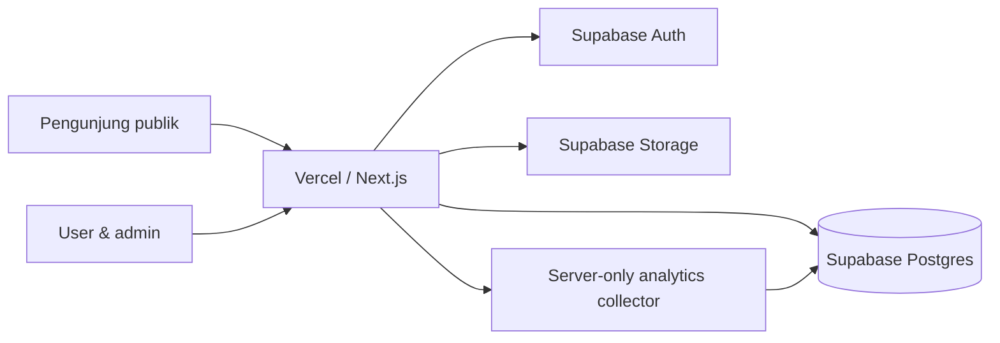

# Technical Design Document — SIT v1.0

```yaml
doc_id: TDD-SIT-001
version: 1.0.0
status: Proposed for implementation
created_at: 2026-10-22
owner: Mas Akmal
source: PRD-SIT-001 v1.0
stack: Next.js 16+ / TypeScript / Tailwind / Supabase / Vercel
```

## 1. Tujuan dan ruang lingkup

SIT adalah platform link-in-bio dengan **1 akun → N halaman → N link**. Setiap halaman memiliki slug, profil, tema, QR, dan analitik sendiri. MVP ditargetkan 14 hari, pilot 2–3 akun, perluasan sampai 10 akun. Masuk MVP: login invitation/admin-provisioned, dashboard multi-page, editor link, drag/drop, tiga template, publikasi, QR, analytics, dan admin. Ditunda: custom domain eksternal, pembayaran, toko, API publik, animasi kompleks, distinct visitors, redirect slug otomatis.

**Perubahan dari PRD yang harus diketahui:** spesifikasi teknis ini menetapkan strategi akses publik *server-side allowlisted projection* (tidak ada grant SELECT anon ke tabel) dan penghapusan user hanya via Admin API tepercaya. Karena PRD tidak memutuskan kebijakan retensi, 90 hari adalah opsi, bukan migrasi otomatis. Library/versi tepat diverifikasi pada implementasi. Tidak ada batas bisnis jumlah halaman, tetapi rate limit operasional tetap diberlakukan.

## 2. Keputusan arsitektur (ADR)

| ADR | Keputusan | Alasan / konsekuensi |
|---|---|---|
| ADR-01 | Satu aplikasi Next.js App Router; path `/{slug}` | Multi-page tanpa deployment per halaman |
| ADR-02 | Supabase Auth + Postgres + Storage | Sedikit komponen operasional |
| ADR-03 | Browser memakai anon/publishable Supabase + RLS; privileged key server-only | Isolasi data lintas akun |
| ADR-04 | Public renderer pakai server-only privileged query **dengan select kolom eksplisit** | Tidak mengekspos draft, email, owner metadata, atau tabel analytics ke anon |
| ADR-05 | Event click melalui `/api/click/[linkId]` GET; `302` ke URL database | Tidak menerima redirect URL arbitrer |
| ADR-06 | Analytics server-only write/read aggregation | Endpoint publik tidak bisa menulis tabel arbitrer |
| ADR-07 | `draft/published/archived`, plus `admin_disabled` | Admin block tak dapat dihapus user |
| ADR-08 | Cache public awalnya `no-store` untuk validitas status; optimasi kemudian | Hindari publikasi draft/cache blokir usang |
| ADR-09 | Database unique constraint sebagai otoritas slug | Menangani race concurrent create |
| ADR-10 | Format slug `^[a-z0-9](?:[a-z0-9-]{1,38}[a-z0-9])$` | Panjang 3–40; ASCII lower-case; karakter aman |

**Batas implementasi:** Next.js Proxy (`src/proxy.ts`) hanya membantu refresh sesi; authorization wajib di Server Actions/Route Handlers dan RLS, bukan hanya Proxy. Penggunaan Vercel pribadi untuk perusahaan wajib ditinjau karena ketentuan Hobby non-komersial.

## 3. Diagram aliran



**Read publik:** GET `/{slug}` → validasi slug → server query `pages` untuk `status=published`, `admin_disabled=false` → query link aktif → render SSR → client-side beacon untuk view (atau server event dedup sesuai desain) → response. Untuk MVP gunakan view event di `/api/events/view` dari browser yang rate-limited. Avoid server-rendered counting karena prefetch/bot/crawler dapat menggelembungkan statistik. Simpan event tanpa IP mentah, UA mentah, atau fingerprint.

**Write dashboard:** autentikasi user → verify `getClaims` + `profiles.is_active` → Zod validation → Supabase scoped client (JWT user) → RLS → mutation → `revalidatePath` pada URL lama/baru bila perlu.

**Admin:** verify user claims + role DB, kemudian operasi provision/disable menggunakan service-role **hanya pada server**; sediakan audit log di aplikasi tahap P1. Jangan mengekspos service-role lewat `NEXT_PUBLIC_`.

## 4. Data dictionary & schema

Migrasi SQL executable ada di [`supabase/migrations/202610220001_initial.sql`](supabase/migrations/202610220001_initial.sql). Jalankan lewat Supabase CLI setelah meninjau migration pada lingkungan staging.

| Tabel | PK | Relasi | Akses |
|---|---|---|---|
| `profiles` | `id` UUID = `auth.users.id` | 1:N `pages` | owner SELECT, update nama; admin via trusted server |
| `pages` | `id` UUID | FK `owner_id` | owner CRUD sesuai peran; admin server |
| `links` | `id` UUID | FK `page_id` | pemilik halaman CRUD |
| `analytics_events` | `id` UUID | FK `page_id`, optional `link_id` | server-only insert/aggregate |

**Constraint:** `pages.slug` UNIQUE + CHECK regex/reserved; title valid; `links.url` hanya http(s) dengan validasi tambahan di Zod (`URL`, hostname dan protokol); analytics click harus merujuk link pada halaman yang sama (trigger). Indeks: `pages.owner_id`, public slug, `links(page_id,sort_order)`, analytics `(page_id,created_at)`.

**Risiko:** CHECK `url ~ '^https?://'` saja bukan URL parser; server wajib memvalidasi URL memakai `new URL()`, menolak kredensial URL, localhost/host internal bila memungkinkan, dan protokol tidak aman. Tidak ada fetch server ke link tujuan. Penambahan private fields di masa depan jangan dimasukkan ke public projection.

### 4.1 Kontrak `theme_config` (versi schema)

```json
{
  "version": 1,
  "template": "minimal",
  "colors": {"background": "#ffffff", "text": "#111827", "button": "#111827", "buttonText": "#ffffff"},
  "font": "sans",
  "buttonRadius": "lg",
  "backgroundStyle": "solid",
  "animation": "subtle"
}
```

Whitelist `template` (`minimal`, `glass`, `bold`), `font` (`sans`, `serif`, `mono`), `buttonRadius` (`sm`,`md`,`lg`,`full`), `animation` (`off`,`subtle`). Jangan masukkan CSS/HTML mentah; batas ukuran JSON perlu diterapkan pada Zod. `social_links` array `{label, url, icon}` dengan maksimal 10 item **usulan engineering**; bisa diubah setelah product approval.

### 4.2 RLS dan grants

SQL migrasi menolak seluruh akses `anon` ke tabel. `authenticated` mendapat grant terbatas serta policy: profiles owner/admin read; owner hanya update `display_name` (column grant), pages owner CRUD dengan `owner_id` immutable di client dan `admin_disabled` immutable; links owner CRUD; analytics none (service-only). Admin status akun dan `admin_disabled` hanya diubah lewat route server dengan secret privileged. Helper `is_admin` dan `is_active_user` `SECURITY DEFINER`, `search_path=''`, dan hanya EXECUTE untuk role `authenticated`.

**Penting:** pengguna nonaktif tetap punya cookie/JWT valid untuk sementara; karena itu setiap mutation memanggil `is_active_user` di RLS dan server memverifikasi status user. Admin mematikan akun di `profiles.is_active` melalui privileged API dan bila diperlukan memaksa revokasi sesi melalui mekanisme Auth yang sesuai. Halaman milik user nonaktif tetap berstatus sesuai data halaman sampai admin secara eksplisit menonaktifkannya: ini **keputusan kebijakan yang belum final**.

### 4.3 Storage

Bucket private `page-assets`. Upload lewat Route Handler server-only: check user owns page (atau admin), magic bytes/MIME, max 2 MB, optionally resize/strip metadata, path `pages/{pageId}/{uuid}.webp`; tulis `avatar_path`. Public renderer menghasilkan signed URL pendek untuk private object **atau** menyediakan image proxy dengan cache aman. Jangan gunakan bucket publik untuk asset yang harus hilang bersama halaman draft tanpa kebijakan eksplisit. Retensi objek lama/cleanup jadi scheduled maintenance tahap P1.

## 5. Struktur repositori

```text
sit/
├── src/
│   ├── app/
│   │   ├── (public)/[slug]/page.tsx
│   │   ├── (public)/[slug]/not-found.tsx
│   │   ├── (auth)/login/page.tsx
│   │   ├── (dashboard)/dashboard/page.tsx
│   │   ├── (dashboard)/dashboard/pages/new/page.tsx
│   │   ├── (dashboard)/dashboard/pages/[id]/edit/page.tsx
│   │   ├── (dashboard)/dashboard/pages/[id]/analytics/page.tsx
│   │   ├── (dashboard)/dashboard/pages/[id]/qr/page.tsx
│   │   ├── (admin)/admin/page.tsx
│   │   ├── (admin)/admin/users/page.tsx
│   │   ├── (admin)/admin/pages/page.tsx
│   │   ├── api/click/[linkId]/route.ts
│   │   ├── api/events/view/route.ts
│   │   ├── api/assets/pages/[pageId]/route.ts
│   │   ├── api/admin/users/route.ts
│   │   ├── api/admin/users/[userId]/route.ts
│   │   ├── api/admin/pages/[pageId]/route.ts
│   │   ├── layout.tsx
│   │   └── page.tsx
│   ├── actions/{pages,links,profile,auth}.ts
│   ├── components/{ui,editor,public-page,dashboard,admin}/
│   ├── features/{pages,links,analytics,qr,themes}/
│   ├── lib/
│   │   ├── supabase/{browser,server,admin,proxy}.ts
│   │   ├── auth/{require-user,require-admin}.ts
│   │   ├── validators/{page,link,theme}.ts
│   │   ├── public-pages.ts
│   │   ├── rate-limit.ts
│   │   ├── result.ts
│   │   └── reserved-slugs.ts
│   ├── types/database.types.ts
│   └── proxy.ts
├── supabase/migrations/202610220001_initial.sql
├── supabase/tests/rls.sql
├── tests/{unit,integration,e2e}/
├── .env.example
├── package.json
└── README.md
```

**Route precedence:** `/{slug}` uses one-segment only. Reserved names list must be synchronized with actual static routes. Prefer `(public)/[slug]` segment plus `src/app/page.tsx` for landing. `src/proxy.ts` must be at same level as `src/app`.

## 6. API contracts

Authentication uses Supabase Auth; CRUD of page/link uses validated Server Actions, not an additional public CRUD API. Responses from route handlers use JSON `{data,error,requestId}` where applicable. Every protected mutation must verify session, active user, ownership, CSRF/origin assumptions, and Zod validation.

| Interface | Method | Actor | Input | Success | Errors |
|---|---|---|---|---|---|
| `createPage` | Server Action | user | `{slug,title}` | `{id,slug}` | validation, conflict, forbidden |
| `updatePage` | Server Action | owner | page ID + allowed fields | page | 400,403,404,409 |
| `setPageStatus` | Server Action | owner | ID + status | status | 403,404 |
| `deletePage` | Server Action | owner | ID + confirmation | success | 403,404 |
| `createLink` | Server Action | owner | page ID,title,url | link | 400,403,404 |
| `updateLink` | Server Action | owner | link ID + allowed fields | link | 400,403,404 |
| `reorderLinks` | Server Action | owner | page ID + ordered link IDs | success | 400,403,409 |
| `/api/click/[linkId]` | GET | public | linkId (UUID) | 302 Location | 404 invalid/disabled |
| `/api/events/view` | POST | public | slug or pageId + consent-free minimal event | 202 | 400,404,429 |
| `/api/assets/pages/[pageId]` | POST | owner | multipart avatar | 201 path | 400,401,403,413,415 |
| `/api/admin/users` | POST | admin | email,display_name,role | 201 user ID | 400,403,409 |
| `/api/admin/users/[userId]` | PATCH | admin | `is_active`,role | 200 | 400,403,404 |
| `/api/admin/pages/[pageId]` | PATCH | admin | `admin_disabled` | 200 | 400,403,404 |

**Atomic reorder:** use database RPC with `SECURITY INVOKER` and ownership verification, or a server-side DB transaction that updates all positions atomically. Don't `Promise.all` independent updates and assume atomicity. If RPC is used, whitelist calls and add SQL tests.

**Example createPage validator:**

```ts
import { z } from 'zod'
export const createPageSchema = z.object({
  slug: z.string().regex(/^[a-z0-9](?:[a-z0-9-]{1,38}[a-z0-9])$/),
  title: z.string().trim().min(1).max(120)
})
```

**Create page server logic:** obtain verified auth claims; assert profile active; parse input; reject reserved slug; insert `{owner_id:claims.sub,slug,title}` with scoped Supabase client; on Postgres `23505` return conflict; never trust `owner_id` from form.

**Analytics click behavior:** resolve active link via server allowlisted select and published/nonblocked page; verify target `http:` or `https:`; record event with server-only client (catch/log failure); return `NextResponse.redirect(url, 302)`; apply rate limit and appropriate cache headers; never accept a target URL from query string.

**Page view behavior:** trigger POST after actual page hydration/visibility where practical; no tracking on previews/draft; validate page published; rate limit; always return non-sensitive responses. This is an event count rather than unique visitors; bot filtering/dedup are deferred.

**Aggregation:** server-only query buckets in chosen timezone (recommend UTC storage + Asia/Jakarta display); total views = count `page_view`; total clicks = count `link_click`, filtering by page ID + date range. Use SQL function limited to server if volume grows; avoid loading unbounded raw events into JS.

## 7. Auth / trust boundaries

1. Admin creates user via server-only Supabase Auth Admin API. Disable self-registration in Auth settings.
2. API inserts corresponding `profiles` row using user UUID; on partial error, compensate/delete Auth user or alert for manual reconciliation.
3. User signs in through Supabase Auth; browser receives session cookies through `@supabase/ssr` integration.
4. `src/proxy.ts` refreshes expired tokens; **not** the authorization boundary.
5. Server dashboard uses `getClaims()` to validate identity and reads `profiles` to reject deactivated users.
6. Page/link writes use JWT-scoped Supabase client so RLS executes.
7. Privileged service-role client is isolated in `server-only` module and only used after server checks for admin or on tightly controlled public-read/event paths.
8. Sign out invalidates user session; test token refresh/logout/multi-tab behavior.

**Important:** never authorize admin access by mutable `user_metadata`; `profiles.role` comes from database server-side. Avoid shared-cache user responses. Apply CSP, security headers, signed uploads, sensible body size/time limits, and application request-rate limits.

## 8. Render, SEO, QR, and UX

- `GET /{slug}` validates slug and fetches only published, nonblocked page; returns `notFound()` otherwise. Explicitly select public fields (`id,title,description,avatar_path,theme_config,social_links,slug`), active link fields (`id,title,url,icon,sort_order`). Never serialize `owner_id`, email, analytics, or internal flags to browser.
- SSR and per-request server check (`no-store` initially) avoid stale block/status. Add CDN caching only after purge/revalidation and test.
- `generateMetadata` returns title/description and canonical URL of published page. Draft/not-found are noindex/not rendered.
- Preview is authenticated; fetch draft from owner-scoped client; disable analytics capture.
- QR encodes absolute canonical URL. Generate client-side SVG/PNG when requested; if slug changes, warn about QR invalidation.
- Each page's theme is sanitized via Zod and rendered with a limited CSS variable set. Respect `prefers-reduced-motion` and avoid expensive JS transitions on landing view.
- Enforce WCAG-inspired keyboard focus/contrast; validate 320/390/768/1440 px viewports.

## 9. Security and failure modes

| Scenario | Expected result |
|---|---|
| User A edits page B | 403 / RLS denies, no change |
| Public tries DB `select pages` directly | denied (no anon grant) |
| User tries updating `pages.admin_disabled` | denied by column grant |
| User tries changing their role | denied by column grant |
| Two users create same slug simultaneously | one succeeds, other unique violation → 409 |
| User inactive but retains JWT | all protected mutations denied through DB active guard + server checks |
| Published page disabled by admin | `/{slug}` returns 404 immediately (no shared stale cache) |
| Analytics store unavailable | public page stays accessible; click redirect proceeds |
| Invalid URL javascript/file/data | rejected during input validation |
| Badly formed image or >2 MB | reject; no object persisted |
| SSR request crawled/prefetched | must not automatically inflate page_view |
| Unauthorized admin API request | 403 before privileged client operation |

**Operational rate limits (proposed):** login by IP/account, create page 20/hour/user, view event 120/minute/IP-or-ephemeral-key, click event 120/minute/IP-or-ephemeral-key. Rate limiting should use a shared durable/edge-compatible store; avoid in-memory global counters in serverless. IP may be processed transiently or hashed in the rate limiter, but not saved in analytics. These numbers are placeholders pending real usage.

## 10. Verification / testing

**SQL tests:** RLS allow/deny for anon, owner A, owner B, admin; verify update of `role`, `is_active`, `owner_id`, `admin_disabled` blocked; verify no direct access to analytics; simultaneous slug insert; trigger link/page consistency. Supabase recommends RLS tests using `supabase test db`.

**Unit:** slug normalize/reserved names; theme JSON validation; URL allowlist; QR absolute URL; status transition rules; analytics aggregation boundaries; formatting.

**Integration:** auth cookie refresh; inactive account; create 3 pages; create links; update/reorder; owner isolation; upload MIME and access; analytics redirect; status block; page/slug conflict.

**E2E:** first admin → provision user → login → create `/layananti`, `/karyati`, `/risetti` → edit independent themes and links → publish → scan QR → collect analytics → archive one → other two still work; viewport 320/390/768/1440, keyboard navigation, reduced motion, browsers Chrome/Firefox/Safari/Edge.

**Release gates:** 0 critical security failures, P0 acceptance tests pass, successful staging migration + restore rehearsal, DNS+TLS valid, uptime monitor configured, cloud-plan business-use reviewed.

## 11. Environment, deployment, and operations

`.env.example` included. Do not commit real secrets. Use separate Supabase projects for development/staging/production if practical; apply version-controlled migrations in pipeline; generate typed TS DB definitions via Supabase CLI. Set `NEXT_PUBLIC_SITE_URL` to canonical domain, verify DNS TLS; force HTTPS. Configure Vercel env per environment, set up monitoring and error logging without PII. Keep private Vercel Preview URLs from public indexing. Verify Vercel Hobby business-use restriction and Supabase free quotas before production; no guarantee free tiers are appropriate for company operations.

**Rollback:** maintain migration/DB backup checkpoint, rollback deployment through Vercel release controls, prefer forward-fix DB migrations over unsafe destructive down-migrations. Separate data rollback from code rollback. Test blocking behavior before go-live.

## 12. Detailed 14-day implementation queue

| Day | Agent task | Exit criterion |
|---|---|---|
| 1 | Scaffold Next/TS/Tailwind + lint/tests + env | clean build and health route |
| 2 | migrations, grants, RLS + RLS tests | A/B isolation passes |
| 3 | Auth SSR proxy, login, admin provision | user can log in, unprovisioned denied |
| 4 | Page CRUD, slug validation, list | three unique pages owned by one user |
| 5 | Profile/avatar/social links | per-page isolation verified |
| 6 | Link CRUD and URLs | active/inactive links work |
| 7 | Order atomicity, user editor | saved drag/drop survives reload |
| 8 | Templates, theme schema, preview | three template variants render |
| 9 | Public renderer, status, metadata | published only, draft 404 |
| 10 | QR, event capture, click redirect | events partitioned by page |
| 11 | Admin users/pages & disable | role guard and block verified |
| 12 | Responsive, reduced-motion, performance | mobile cross-width checks |
| 13 | Security tests, regression, backups | all P0 acceptance tests pass |
| 14 | Vercel/DNS, smoke, pilot 2–3 users | URL live with monitoring |

### 12.1 AI coding agent execution protocol

For **each task**, the agent must: (a) review relevant PRD IDs and this TDD, (b) list files to change, (c) implement smallest vertical slice, (d) add tests including negative/security cases, (e) run typecheck/lint/unit/integration build, (f) report changed files, commands and test results, (g) stop on failing gates instead of declaring complete. Never silently expand P0 or add an alternative auth/database provider. Do not remove RLS to fix permission errors; investigate grants and policy conditions. No production deploy or credential exposure without user authorization.

**Starter prompt to agent:**

> Implement SIT based on PRD-SIT-001 v1.0 and TDD-SIT-001. Begin with Day 1 only. Use Next.js App Router, TypeScript, Tailwind, Supabase. Enforce multi-page per account and global unique slug from day one. Respect deny-by-default grants/RLS and server-only privileged keys. Produce code, migrations/tests and a concise verification report. Do not deploy or proceed to the next day until the acceptance criteria pass.

## 13. Open decisions

1. Final production hostname (known to owner, not provided in PRD).
2. Business-appropriate Vercel plan and cost.
3. Target duration of analytics retention, backup and restore responsibilities.
4. Whether deactivating user auto-hides all their published pages.
5. Whether slug change keeps old route as redirect; MVP assumes no.
6. Whether page deletion is hard delete or soft delete; current SQL supports hard delete, but UI should default to archive.
7. Whether an avatar should remain accessible after archive; current private-storage policy supports control at response time.
8. Formal approval of suggested numerical SLO/rate limits.

## 14. References (checked 2026-10-22)

- [Next.js App Router](https://nextjs.org/docs/app)
- [Next.js Proxy](https://nextjs.org/docs/app/getting-started/proxy)
- [Supabase SSR client setup](https://supabase.com/docs/guides/auth/server-side/creating-a-client?framework=nextjs&queryGroups=framework)
- [Supabase RLS](https://supabase.com/docs/guides/database/postgres/row-level-security)
- [Vercel terms of service](https://vercel.com/legal/terms)
